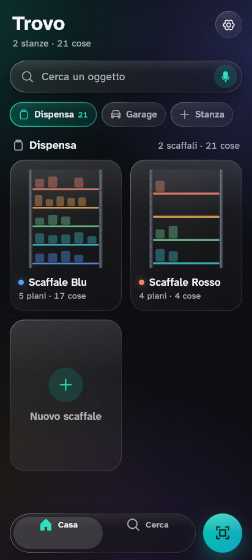
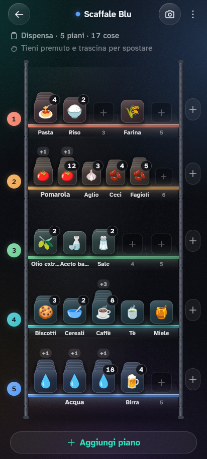
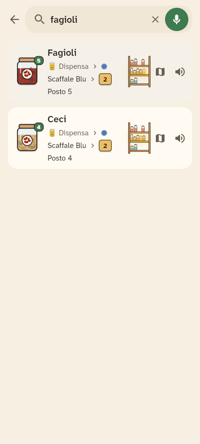
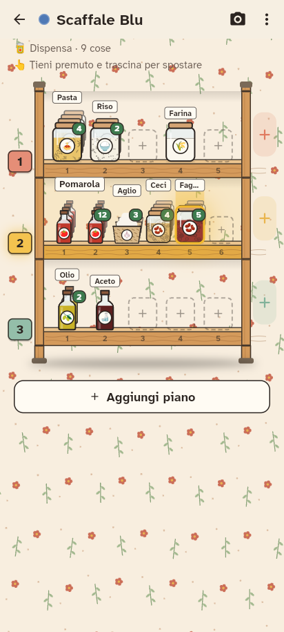
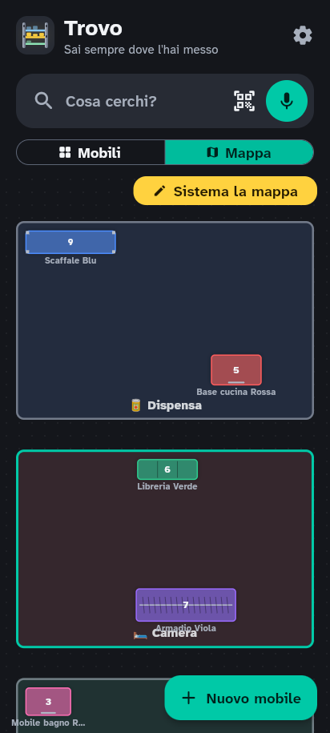
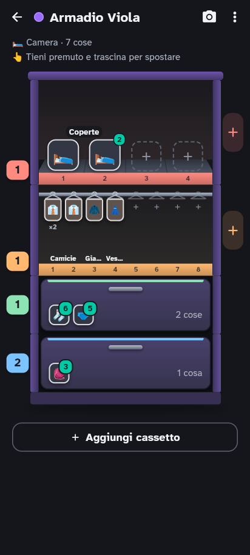
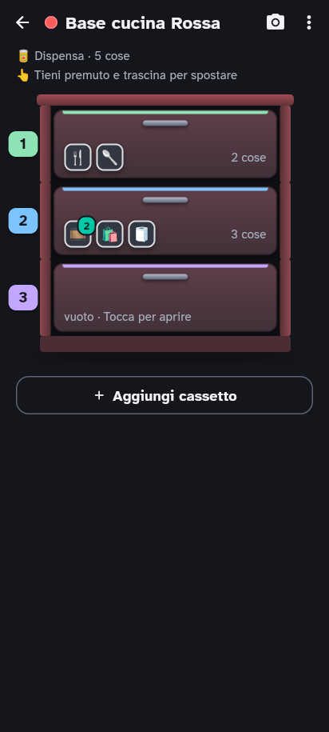
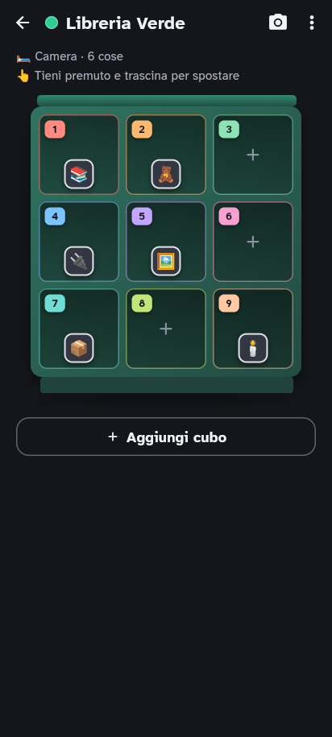

# 🔦 Trovo

**Sai sempre dove l'hai messo.**

Trovo è un'app per Android (e più avanti iPhone) che ti dice dove hai messo le cose
negli scaffali di casa: dispensa, garage, cantina…

Pensata per chi si dimentica le cose (ADHD, dislessia, o semplicemente troppi scaffali).

<p>
  
  
  
  
</p>
<p>
  
  
  
  
</p>

## Cosa fa

- 🏠 **Stanze**: dispensa, garage, cantina… quante ne vuoi.
- 🗄️ **Scaffali in ferro** disegnati come quelli veri, con **quanti piani vuoi** (da 1 a 30).
- 🪑 **Tutti i mobili**: cassettiere, armadio con le grucce, libreria a cubi, base e pensile
  della cucina, mobile del bagno, comodino. Li scegli già pronti e li regoli.
- 🗺️ **Mappa della casa vista dall'alto**: le stanze e i mobili come su una piantina.
  Tocchi un mobile e si apre. Con "Sistema la mappa" sposti stanze e mobili come nella realtà.
- 🎨 **Ogni piano ha un colore e un numero grande**: ti ricordi "il piano rosa".
- 🔎 **Ricerca che perdona gli errori**: "pasatta" trova la passata, "pomodori" trova i pelati.
- 🎤 **Ricerca a voce**: "Dov'è la passata?". Trovo ti risponde a voce:
  "Passata: Dispensa, Scaffale Blu, piano 2". Niente AI esterne: usa la voce del telefono.
- 🔦 **Animazione Faro**: lo scaffale si apre, il piano giusto si accende di giallo
  e l'oggetto pulsa.
- ⚡ **Aggiunta a raffica**: metti tante cose una dopo l'altra, senza riscegliere il piano.
- 😀 **Emoji automatiche**: scrivi "tonno" e appare 🐟.
- 📷 **Foto del piano** per ricordarti com'è fatto.
- 👉 **Scorri per dire "finito"**, con il tasto Annulla se sbagli.
- 💾 **Backup** in un file, da salvare dove vuoi.
- 🇮🇹 🇬🇧 Italiano e inglese.
- ♿ Font **Atkinson Hyperlegible** (pensato per leggere facile), testo grande, alto contrasto,
  rispetta "riduci animazioni" del telefono.

I dati restano **solo sul telefono**. Nessun account.

## Come è fatta

App **Flutter** (Dart). Le parti principali:

| File | Cosa fa |
|---|---|
| `lib/models.dart` | Stanza → Scaffale → Piano → Oggetto |
| `lib/store.dart` | Salvataggio sul telefono, backup |
| `lib/search.dart` | Ricerca che perdona errori e capisce sinonimi |
| `lib/emoji_guess.dart` | Emoji indovinata dal nome |
| `lib/widgets/shelf_art.dart` | Disegno degli scaffali in ferro |
| `lib/screens/` | Le schermate: Home, Scaffale, Piano, Cerca, Impostazioni |
| `lib/l10n/strings.dart` | Tutti i testi in italiano e inglese |

## Comandi utili

```bash
flutter pub get          # scarica le librerie
flutter test             # prova che tutto funzioni
flutter run              # avvia l'app sul telefono collegato
flutter build apk        # crea il file .apk da installare
flutter build appbundle  # crea il file .aab per il Play Store
```

## Per pubblicare sul Play Store (dopo)

1. Crea una chiave di firma tua (`keytool -genkey ...`) e configurala in
   `android/app/build.gradle.kts` (ora l'app è firmata con la chiave di prova).
2. `flutter build appbundle`
3. Carica il file `.aab` sulla Google Play Console.
